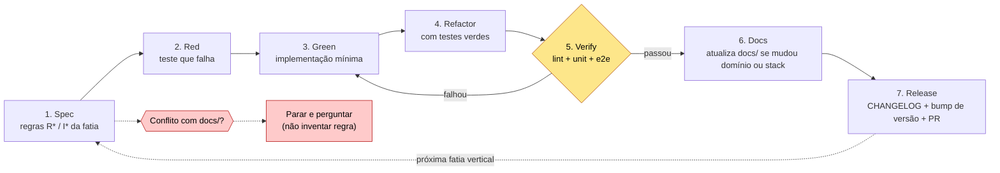

# NestJS Planner API

### About

Caso de desafio backend para a construção de um prontuário eletrônico em NestJS, com desenvolvimento assistido por IA (harness). Requisitos e engenharia (**DDD**, **TDD**, fluxo agêntico): **[documentação em `docs/`](./docs/README.md)** — comece pelo [PRD](./docs/prd.md).

---

### Fluxo de trabalho (harness)

Cada entrega é uma **fatia vertical**, construída com TDD e verificação explícita. Detalhes em [architecture.md](./docs/architecture.md) e na ordem das fatias em [domain.md](./docs/domain.md#mapeamento-prd--fatias-verticais-ordem-sugerida).



---

### Setup

Node é fixado em [`.nvmrc`](./.nvmrc) (24.21.0) e em `engines` no `package.json`.

```
$ nvm use
$ docker compose up -d                 # Postgres dev (:5432) e teste (:5433)
$ cd planner-api
$ cp .env.example .env
$ cp .env.test.example .env.test
$ yarn install                        # também gera o Prisma Client
```

Swagger em http://localhost:3000/docs e healthcheck em http://localhost:3000/health.

---

### Run

```
$ cd planner-api
$ yarn start:dev
```

API em container (opcional): `docker compose --profile api up`. Detalhes em [docker-compose.yml](./docker-compose.yml) e [architecture.md](./docs/architecture.md).

---

### Validate

```
$ nvm use
$ cd planner-api
$ yarn lint
$ yarn test
$ yarn test:e2e
```

O `yarn install` ativa os git hooks de [`.githooks/`](./.githooks): o `pre-commit` roda `yarn lint` e o `pre-push` roda lint + unit + e2e (precisa do Postgres de teste no ar). Não use `--no-verify`. A `main` é protegida: só recebe PR com os checks de CI verdes.
