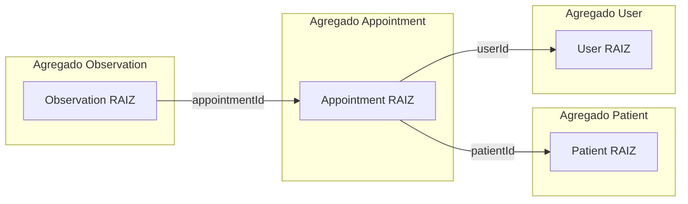

# Domínio — Planner API

## Propósito

Modelo de domínio e regras de negócio derivadas do [PRD](./prd.md), para orientar implementação **DDD** e testes **TDD** no fluxo agêntico descrito em [architecture.md](./architecture.md). Vocabulário: [glossary.md](./glossary.md).

---

## Contexto delimitado

**Planner / prontuário simplificado:** suporte ao trabalho do **médico** com **pacientes**, **agenda de consultas** e **registro de observações** clínicas por atendimento. Não inclui billing, prescrição eletrônica, integração com laboratórios ou portal do paciente na v1.

**Ator principal:** médico, representado por um `User` com `role = DOCTOR`. Paciente não autentica no escopo inicial do case.

---

## Linguagem ubíqua (resumo)

| Termo              | Significado no domínio                                                                  |
| ------------------ | --------------------------------------------------------------------------------------- |
| Paciente           | Pessoa cadastrada com dados demográficos e antropométricos                              |
| Usuário            | Identidade do usuário do sistema                                                        |
| Médico             | Usuário com `role = DOCTOR`, profissional responsável pela agenda e autor das anotações |
| Agendamento        | Slot de consulta entre médico e paciente em intervalo de tempo                          |
| Observação         | Texto clínico/anotação vinculada a um agendamento                                       |
| Agenda             | Conjunto de agendamentos de um médico                                                   |
| Perfil do paciente | Dados cadastrais editáveis do paciente                                                  |
| Histórico clínico  | Conjunto de observações associadas aos agendamentos de um paciente                      |

---

## Agregados e entidades

Convenção: **raiz de agregado** possui identidade própria e expõe `uuid` na API. Referências entre agregados usam identidade (`uuid` ou id interno, conforme a camada), e não objetos ou agregados aninhados.

### Agregado `Patient` (Paciente)

**Raiz:** `Patient`

| Campo                             | Regra                                                             |
| --------------------------------- | ----------------------------------------------------------------- |
| name, phone, email                | Obrigatórios no cadastro (PRD); formatos validados na borda (DTO) |
| birthDate, gender, height, weight | Obrigatórios no cadastro (PRD)                                    |
| name                              | Normalizado (trim); vazio após o trim → 400                       |
| phone                             | Formato E.164                                                     |
| email                             | Normalizado (trim + minúsculas); único entre pacientes ativos; duplicata → 409 |
| birthDate                         | `YYYY-MM-DD`; não pode ser futura                                 |
| gender                            | `MALE`, `FEMALE`, `OTHER` ou `NOT_INFORMED`                       |
| height                            | Inteiro em cm, de 30 a 300                                        |
| weight                            | Decimal(5,2) em kg, de 0.5 a 700; exposto na API como `number`    |
| uuid                              | Identidade gerada pela aplicação (UUID v4) na criação; sem default no banco; imutável |
| deletedAt                         | Soft delete; listagens padrão ignoram excluídos                   |

**Comportamentos (casos de uso):**

* Cadastrar paciente
* Listar pacientes ativos
* Editar perfil
* Consultar paciente por `uuid` (`GET /patients/:uuid`)

A listagem é paginada com `?page&limit` (default 20, máximo 100) e responde `{ data, meta: { page, limit, total } }`.

A edição (`PATCH /patients/:uuid`) é parcial: campos omitidos não mudam; `null` em qualquer campo → 400 (todos são obrigatórios).

Violação de regra de domínio lança `DomainError` (sem dependência de HTTP); o `DomainErrorFilter` global a traduz para 400 no mesmo formato do `ValidationPipe`, com `message` sempre array.

**Consistência:**

Alterações de perfil não alteram agendamentos passados; a identidade do paciente (`uuid`) permanece estável.

---

### Agregado `User` (Usuário)

**Raiz:** `User`

`User` representa a identidade do usuário do sistema. No contexto atual, um médico é representado por um `User` cujo `role` é `DOCTOR`.

| Campo                | Regra                                                                                |
| -------------------- | ------------------------------------------------------------------------------------ |
| email                | Identificação do usuário; único. Nome fica fora até uma fatia precisar dele          |
| uuid                 | Identidade gerada pela aplicação (UUID v4); sem default no banco; imutável           |
| email                | Único                                                                                |
| passwordHash         | Credencial armazenada como hash; nunca armazenar senha em texto puro. **Opcional até a fatia Auth (#30)**, que decide se passa a ser obrigatório |
| role                 | `DOCTOR` (médico) ou `ADMIN` (papel não clínico, sem agenda); define o papel/autorização |
| deletedAt            | Soft delete                                                                          |

**Comportamentos:**

* Cadastro/gestão mínima de usuários: sem CRUD nem endpoint nesta fase; os usuários vêm do seed de desenvolvimento (`prisma/seed.ts`, um `DOCTOR` com uuid fixo) ou de `createUser` nos e2e
* Não existe `GET /doctors`: o `doctorUuid` usado ao agendar vem do seed
* Vinculação de agendamentos ao usuário responsável
* Autenticação/JWT fora do slice inicial, salvo issue específica de auth
* Autorização baseada em `role` quando autenticação estiver implementada

**Consistência:**

* Um `User` com `role = DOCTOR` pode atuar como médico no domínio.
* Não existe agregado `Doctor` separado.
* `Appointment` referencia o `User` responsável por meio de `userId`.
* A aplicação deve validar que o `User` associado ao agendamento possui `role = DOCTOR`.

---

### Agregado `Appointment` (Agendamento de consulta)

**Raiz:** `Appointment`

O `Appointment` representa o vínculo entre um paciente e um médico em determinado intervalo de tempo.

| Campo              | Regra                                                                 |
| ------------------ | --------------------------------------------------------------------- |
| patientId          | Deve referenciar paciente existente e não excluído                    |
| userId             | Deve referenciar `User` existente, não excluído e com `role = DOCTOR` |
| startTime, endTime | Intervalo válido: `startTime < endTime`                               |
| description        | Contexto/motivo do agendamento; trim, de 1 a 1000 caracteres          |
| deletedAt          | Soft delete; exclusão lógica do agendamento                           |

**Relacionamentos:**

* Um `Appointment` pertence a um `Patient`.
* Um `Appointment` pertence a um `User` com `role = DOCTOR`.
* Um `Appointment` pode possuir zero ou várias `Observation`.
* `Observation` não faz parte da identidade do `Appointment`.

**Comportamentos (casos de uso):**

* Cadastrar agendamento para paciente
* Listar, alterar e excluir agendamentos
* Consultar observações associadas ao agendamento
* Consultar histórico de observações de um paciente

**Referências:**

O agregado referencia `Patient` e `User` por identidade. A camada de aplicação valida a existência e o estado dos agregados referenciados antes de persistir o agendamento.

**Decisões de Spec (fatia Appointment, #24):**

* **Tempo:** `startTime`/`endTime` em ISO 8601 com offset obrigatório (`Z` ou `±hh:mm`); sem offset ou só a data → 400. Colunas `@db.Timestamptz(3)`; a resposta sai sempre em UTC (`toISOString()`).
* **Intervalo:** I1 garantida pelo VO `TimeRange` (`DomainError` → 400); `start == end` também é 400. Agendamento no passado é permitido (registro de consultas realizadas); sem duração máxima.
* **Referências:** paciente inexistente/excluído ou médico inexistente/excluído/`ADMIN` → 404, ao criar e ao trocar o médico. Se o paciente ou o médico for excluído depois, o agendamento continua visível (histórico, R10) e passa a ser **só leitura**: `PATCH` em agendamento cujo paciente está excluído, ou cujo médico atual está excluído ou sem `role = DOCTOR`, → **409**, para qualquer corpo (só `description`, o mesmo `doctorUuid`, troca para um médico válido e até `{}`). O `DELETE` desse agendamento continua permitido (#47).
* **PATCH:** edita `startTime`, `endTime`, `description` e `doctorUuid`; `patientUuid` é imutável (400). O intervalo é validado com os valores combinados (atuais + novos). `doctorUuid` igual ao atual (sem diferenciar maiúsculas/minúsculas) não revalida o médico. Ordem das checagens: agendamento inexistente/excluído → 404; paciente ou médico atual inativo → 409; regras do agregado (I1, `description`) → 400; novo médico inválido → 404. A gravação exige `deletedAt` nulo: se o agendamento for excluído entre a leitura e a escrita, o `PATCH` responde 404 (o mesmo vale para `PATCH /patients/:uuid`).
* **DELETE:** soft delete → 204; inexistente ou já excluído → 404; **409 se houver `Observation` ativa** (#52). Roda em `$transaction` com lock da linha (`SELECT … FOR UPDATE`), o mesmo do `POST` de observação (ver Decisões de Spec da fatia Observation).
* **Listagem:** paginada como a de Patient, ordenada por `startTime` e, em empate, por `id`; sem filtros nesta fatia (a Auth restringirá ao médico logado).
* **Limitação consciente de tempo (#27):** `startTime`/`endTime` guardam um instante em UTC (`Timestamptz`), sem o offset nem o fuso de origem. Basta para clínica única e para comparação e sobreposição (R9). Fica fora de escopo o fuso IANA da clínica (`timeZone`, ex.: `America/Sao_Paulo`), necessário para exibir no horário local da clínica, para agendamentos futuros que sobrevivam a mudanças de horário de verão e para recorrência; se a internacionalização virar requisito, adiciona-se essa coluna, sem trocar o tipo. `createdAt`/`updatedAt` seguem `timestamp(3)` sem fuso, no padrão de `patients`/`users` (o Prisma grava em UTC).

---

### Agregado `Observation` (Observação)

**Raiz:** `Observation`

Uma `Observation` representa uma anotação clínica registrada no contexto de um `Appointment`.

| Campo         | Regra                                                      |
| ------------- | ---------------------------------------------------------- |
| appointmentId | Deve referenciar um `Appointment` existente e não excluído |
| message       | Texto da observação clínica; obrigatório                   |
| createdAt     | Data/hora de criação da observação                         |
| updatedAt     | Data/hora da última alteração                              |
| deletedAt     | Soft delete da observação                                  |

**Relacionamento:**

* Uma `Observation` pertence a exatamente um `Appointment`.
* Um `Appointment` pode possuir zero ou várias `Observation`.
* `Observation` não referencia diretamente `Patient` ou `User`.
* O paciente e o médico da observação são determinados indiretamente pelo `Appointment`.

**Comportamentos (casos de uso):**

* Registrar observação para um agendamento
* Consultar observações de um agendamento
* Atualizar observação
* Excluir observação
* Consultar histórico de observações de um paciente

**Consistência:**

* Não é permitido criar uma `Observation` para um `Appointment` inexistente.
* Não é permitido criar uma `Observation` para um `Appointment` soft-deleted.
* A exclusão de uma `Observation` não exclui o `Appointment`.
* A alteração dos dados do `Patient` ou `User` não altera o conteúdo histórico da `Observation`.
* A `Observation` mantém sua própria identidade (`uuid`).

**Decisões de Spec (fatia Observation, #49):**

* **Rotas:** `POST /appointments/:uuid/observations` (201), `GET /appointments/:uuid/observations` (R7, paginado), `GET /observations/:uuid`, `PATCH /observations/:uuid` (R6), `DELETE /observations/:uuid` (204, soft delete) e `GET /patients/:uuid/observations` (R8, paginado). Só o `uuid` é exposto; a resposta traz `uuid`, `appointmentUuid`, `message`, `createdAt` e `updatedAt`.
* **Modelo (I5, I6):** a tabela `observations` tem uma única FK, `appointmentId`; não há `patientId` nem `userId`. O paciente e o médico vêm do agendamento.
* **`message`:** obrigatória, com trim, de 1 a 5000 caracteres (coluna `Text`); ausente, vazia, só espaços, `null`, não string ou longa demais → 400. Campos extras (ex.: `patientUuid`) → 400. A regra vive na entidade `Observation` (`register`, `changeMessage`, `markDeleted`) e lança `DomainError`.
* **I4:** agendamento inexistente ou excluído → 404, ao criar e ao listar.
* **Histórico só leitura:** se o paciente do agendamento estiver excluído, ou o médico estiver excluído ou sem `role = DOCTOR`, criar ou editar observação → **409**, como o `PATCH` de agendamento (#47). A leitura continua liberada. Ordem das checagens no `POST`: `message` → 400; agendamento inexistente/excluído → 404; paciente ou médico inativo → 409.
* **Concorrência:** o `POST` de observação roda em `$transaction` com lock da linha do agendamento (`SELECT … FOR UPDATE`) desde a fatia 1/4 (#50); o `DELETE` de agendamento usa o mesmo lock desde a fatia 3/4 (#52). Com os dois, um agendamento não é excluído enquanto uma observação é criada. `PATCH` e `DELETE` de observação gravam com `deletedAt: null` no `where`: se a observação for excluída entre a leitura e a escrita, a resposta é 404.
* **DELETE de observação:** soft delete → 204; inexistente ou já excluída → 404. Não exclui o agendamento. É permitido mesmo com paciente ou médico inativo (só criar e editar recebem 409), como o `DELETE` de agendamento (#47).
* **Leituras:** paginação igual à de Patient. R7 ordena por `createdAt` e, em empate, por `id`. R8 ordena por `appointment.startTime`, depois `createdAt` e `id`. `GET /observations/:uuid` filtra só a própria observação (agendamento excluído → continua 200), enquanto a lista de R7 responde 404 para agendamento excluído. Observações excluídas não aparecem; as de agendamento ou paciente excluído continuam no histórico de R8, porque o paciente só some com o LGPD (R10).

---

## Relação entre agregados

`Patient`, `User`, `Appointment` e `Observation` são agregados independentes.

As referências entre agregados ocorrem por identidade, evitando que um agregado precise carregar ou alterar outro agregado diretamente.



### Regra arquitetural

A referência entre agregados deve ser feita por identidade, e não por objeto:

```text
Observation
    |
    +-- appointmentId
             |
             v
       Appointment
          |      |
          |      +-- userId --> User
          |
          +-- patientId --> Patient
```

Isso permite que cada agregado tenha ciclo de vida e consistência próprios.

---

## Regras de negócio

### Obrigatórias (PRD)

| ID | Regra                                                     | Verificação sugerida (TDD)                  |
| -- | --------------------------------------------------------- | ------------------------------------------- |
| R1 | Paciente cadastrado com todos os campos exigidos          | e2e POST 400 se faltar campo; 201 se válido |
| R2 | Listar e editar perfil de pacientes cadastrados           | e2e GET/PATCH                               |
| R3 | Cadastrar agendamento vinculado a paciente e médico       | e2e POST appointment                        |
| R4 | Listar, alterar e excluir agendamentos                    | e2e GET/PATCH/DELETE                        |
| R5 | Registrar observação vinculada a um agendamento existente | e2e POST observation                        |
| R6 | Atualizar observação existente                            | e2e PATCH observation                       |
| R7 | Listar observações de um agendamento                      | e2e GET appointment/:id/observations        |
| R8 | Visualizar histórico de observações dos pacientes         | e2e GET por patientId/uuid                  |

### Desejáveis (PRD)

| ID  | Regra                                                                                                         | Notas de implementação                                                                                                                                     |
| --- | ------------------------------------------------------------------------------------------------------------- | ---------------------------------------------------------------------------------------------------------------------------------------------------------- |
| R9  | **Agenda:** mesmo médico não pode ter dois agendamentos com sobreposição de horário                           | Domínio: função `intervalsOverlap(a,b)`; rejeitar com 409 Conflict                                                                                         |
| R10 | **LGPD:** excluir/anonimizar dados pessoais do paciente mantendo histórico de agendamentos para contabilidade | PII do `Patient` anonimizada ou removida; `Appointment` e `Observation` retêm somente o vínculo técnico necessário — detalhar política antes do slice LGPD |

### Invariantes (sempre verdadeiras)

* I1: `startTime < endTime` em todo agendamento persistido.
* I2: Não criar agendamento para paciente inexistente ou soft-deleted.
* I3: Não criar agendamento para `User` inexistente, soft-deleted ou sem `role = DOCTOR`.
* I4: Não criar observação para agendamento inexistente ou soft-deleted.
* I5: Toda `Observation` pertence a exatamente um `Appointment`.
* I6: `Observation` não possui vínculo direto com `Patient` ou `User`.
* I7: APIs REST expõem recursos coerentes com [architecture.md](./architecture.md) (JSON, códigos HTTP adequados).

---

## Política LGPD (rascunho para implementação)

Quando R10 for implementada:

1. **Solicitação de exclusão de dados pessoais** do paciente.

2. **Campos PII** (`name`, `phone`, `email`, `birthDate`, etc.) anonimizados ou substituídos por placeholders irreversíveis.

   * `email`: substituído por `anon-<uuid>@anonymized.invalid`, com `<uuid>` igual ao `uuid` do paciente. O valor é determinístico (mantém a operação idempotente) e único, compatível com o índice único parcial de `patients.email`.
   * O TLD `.invalid` é reservado pela [RFC 2606](https://www.rfc-editor.org/rfc/rfc2606) (detalhado na [RFC 6761](https://www.rfc-editor.org/rfc/rfc6761)) e nunca resolve na internet: o valor não colide com um email real nem recebe mensagens.
   * É uma escolha técnica, não uma exigência da LGPD, que não prescreve formato de placeholder.

3. **Agendamentos** permanecem com horários e demais dados necessários para retenção histórica.

4. **Observações clínicas** permanecem sujeitas à política específica de retenção e anonimização definida para o prontuário.

5. Vínculos técnicos entre `Patient`, `Appointment` e `Observation` devem impedir reidentificação indevida após anonimização.

6. Operação **idempotente** e auditável (`updatedAt`).

Ajuste fino jurídico/produto deve ser registrado neste arquivo antes do agente implementar o caso de uso.

---

## Fora de escopo (v1)

* Multi-tenant / clínicas / equipes
* Paciente como usuário autenticado
* Notificações (SMS/e-mail) de lembrete
* Prontuário completo (CID, anexos, receitas)
* Relatórios financeiros além de retenção mínima citada no PRD
* Versionamento/auditoria completa das observações
* Anexos ou arquivos associados às observações

---

## Mapeamento PRD → fatias verticais (ordem sugerida)

1. **Patient** — R1, R2
2. **Appointment** — R3, R4
3. **Observation** — R5, R6, R7, R8
4. **User + Auth** — JWT e autorização (desejável PRD)
5. **Agenda** — R9
6. **LGPD** — R10

Cada fatia:

```text
teste que falha
      ↓
implementação mínima
      ↓
refatoração
      ↓
lint
      ↓
unit tests
      ↓
integration tests
      ↓
e2e tests
      ↓
commit
```

O fluxo agêntico deve respeitar as regras deste documento antes de criar ou modificar entidades, casos de uso, repositories ou endpoints.
